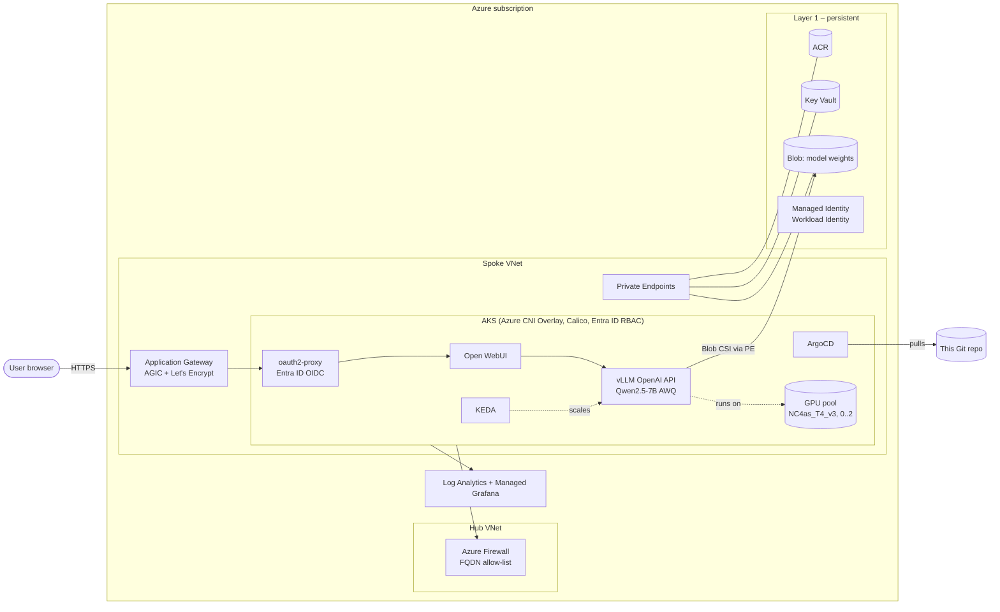

# Private LLM Inference Platform on Azure AKS (GPU)

A production-style, self-hosted LLM platform on Azure Kubernetes Service: **Qwen2.5-7B-Instruct (AWQ) served by vLLM on NVIDIA T4 GPUs**, fronted by an Entra ID–protected chat UI, deployed end-to-end with **layered Terraform + ArgoCD GitOps**, with all egress forced through Azure Firewall.

> Built as a hands-on reference for running private AI inference in a regulated-style environment: identity-first access, no public data-plane endpoints, policy-scanned IaC, and GPU cost control.

---

## Architecture



## What's in it

| Area | Implementation |
|---|---|
| **GPU inference** | vLLM `v0.6.4` (OpenAI-compatible API) serving Qwen2.5-7B-Instruct, AWQ 4-bit (~5 GiB) on a single T4 (16 GiB). Dedicated GPU node pool with `nvidia.com/gpu` taint, NVIDIA device plugin, autoscaling **0–2 nodes**. |
| **Model storage** | Weights live in Blob Storage (Layer 1) and are mounted via the Blob CSI driver over a private endpoint — the cluster can be destroyed without re-downloading models. |
| **Autoscaling** | KEDA `ScaledObject` for the inference deployment; cluster autoscaler on user and GPU pools. |
| **GitOps** | ArgoCD app-of-apps with separate `platform` and `workloads` AppProjects. Platform: cert-manager, ingress-nginx, KEDA, oauth2-proxy, NVIDIA device plugin. Workloads: `qwen-api` and `open-webui` Helm charts (in-repo). |
| **Identity & access** | Entra ID–integrated AKS RBAC with local accounts disabled; Entra groups managed in Terraform; oauth2-proxy (OIDC) in front of the chat UI; **Workload Identity** (federated credential) for pod → Azure access — no static cloud credentials in the cluster. |
| **Network security** | Hub-spoke VNets, `outbound_type = userDefinedRouting` so **all egress goes through Azure Firewall** with an explicit FQDN allow-list (AKS, MCR, Hugging Face, Let's Encrypt, …). Private endpoints + private DNS for ACR, Key Vault and Storage. Calico NetworkPolicies and PodDisruptionBudgets on the inference workload. API server restricted to authorized IP ranges. |
| **Observability** | Log Analytics (diagnostic settings for AKS) and Azure Managed Grafana. |
| **IaC quality** | Checkov policy scanning (`.checkov.yaml` documents every skipped check and why), pinned chart/image versions, `terraform validate`-clean modules. |

## Two-layer Terraform: why

GPU clusters are expensive to leave running. The infrastructure is split by lifecycle:

| Layer | Contents | Lifecycle |
|---|---|---|
| `terraform/layer1-persistent` | Remote state, ACR, Key Vault, model-weights storage, managed identity, Entra groups | Created once, rarely changes |
| `terraform/layer2-ephemeral` | Hub-spoke network, Azure Firewall, App Gateway, AKS + GPU pool, monitoring, ArgoCD, workload secrets | **Destroy when idle, recreate in one apply** |

Layer 2 reads Layer 1 through `terraform_remote_state`, so tearing down the expensive part never loses images, models, secrets or identities. ArgoCD then reconciles every workload back from Git.

## Repository layout

```
terraform/
  layer1-persistent/   # state backend bootstrap, ACR, KV, storage, identity, groups
  layer2-ephemeral/    # networking, firewall, AKS, monitoring, argocd, workload-secrets
gitops/
  bootstrap/           # ArgoCD install values + root app-of-apps
  projects/            # AppProjects (platform / workloads)
  platform-apps/       # cert-manager, ingress-nginx, keda, oauth2-proxy, nvidia-device-plugin
  workload-apps/       # qwen-api, open-webui
  charts/              # in-repo Helm charts
  envs/dev/            # per-environment values
scripts/               # model upload, ArgoCD bootstrap/import, validation
docs/runbooks/         # bootstrap, Qwen deployment, oauth2-proxy/Entra setup, vLLM troubleshooting
```

## Deploy (summary)

1. **Layer 1** – bootstrap remote state, then `terraform apply` in `terraform/layer1-persistent`.
2. **Upload model weights** – `AZURE_SUBSCRIPTION_ID=... scripts/upload-model.sh`.
3. **Layer 2** – copy `terraform.tfvars.example` → `terraform.tfvars`, fill in subscription/tenant, your IP, `public_domain` and the oauth2-proxy app IDs; apply with `argocd_enabled = false`, then again with `true`.
4. **GitOps** – ArgoCD syncs platform apps, then workloads. Point the `repoURL`s in `gitops/` at your fork and replace `example.com` / `<placeholders>` in `gitops/envs/dev/`.

Detailed steps: [`docs/runbooks/gpu-stack-bootstrap.md`](docs/runbooks/gpu-stack-bootstrap.md) and [`docs/runbooks/qwen-deployment.md`](docs/runbooks/qwen-deployment.md).

## Lessons learned (highlights)

- `accelerator` is a reserved AKS node-label key — use a custom key (`gpu-type`) for GPU scheduling.
- KEDA rejects a CPU trigger with `minReplicaCount: 0`; true scale-to-zero needs an HTTP/Prometheus-based trigger.
- With forced tunneling through Azure Firewall, cert-manager's HTTP-01 self-check needs an explicit firewall rule back to the public hostname.
- AKS Workload Identity needs **both** `oidc_issuer_enabled` and `workload_identity_enabled` set explicitly.

More in [`docs/runbooks/vllm-troubleshooting.md`](docs/runbooks/vllm-troubleshooting.md).

## Roadmap

- [ ] HTTP-based KEDA trigger for true pod scale-to-zero
- [ ] vLLM Prometheus metrics → Grafana dashboard (tokens/s, queue depth, GPU utilisation)
- [ ] Azure Policy / Kyverno guardrails (allowed GPU SKUs, required labels)
- [ ] CI pipeline: `terraform validate`, Checkov and Helm lint on every PR

---

**Author:** Md Harunur Rashid — Senior DevOps Engineer, Azure / AKS platform engineering · [LinkedIn](https://www.linkedin.com/in/engrashid)
