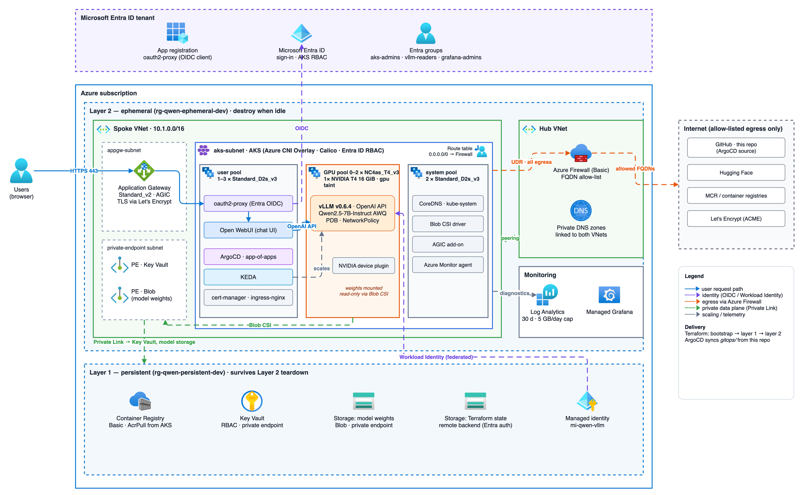
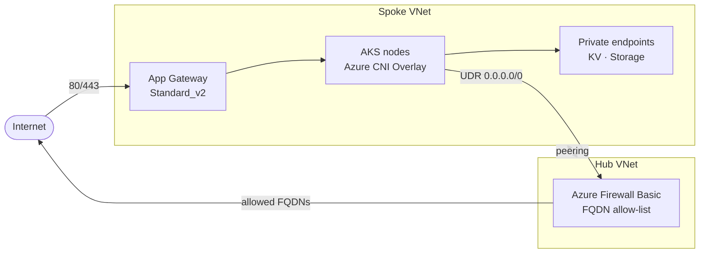

# Architecture

This document describes how the platform is put together and why.

The diagram source is [`images/architecture.drawio`](images/architecture.drawio);
edit it in [diagrams.net](https://app.diagrams.net) or the draw.io desktop app and
re-export the PNG (`draw.io -x -f png --scale 1.5 --border 20 -o docs/images/architecture.png docs/images/architecture.drawio`).

## Goals

- **Private inference:** the model runs inside your subscription; prompts never
  leave it except through explicitly allowed egress.
- **Identity first:** every human and workload authenticates with Entra ID — no
  static cloud credentials in the cluster.
- **Cost control:** the expensive GPU layer can be destroyed and recreated
  without losing models, images, secrets or identities.
- **Everything as code:** Terraform for Azure, ArgoCD for in-cluster state.

## Layers

| Layer | Path | Lifecycle | Contents |
|---|---|---|---|
| Bootstrap | `terraform/layer1-persistent/bootstrap` | Once, local state | Resource group + storage account/containers for remote state |
| Layer 1 – persistent | `terraform/layer1-persistent` | Long-lived | ACR (Basic), Key Vault (standard, RBAC), model-weights storage, user-assigned managed identity for vLLM, Entra security groups |
| Layer 2 – ephemeral | `terraform/layer2-ephemeral` | Destroy when idle | Hub/spoke VNets, Azure Firewall (Basic), route table, NSGs, private endpoints + private DNS, Application Gateway (Standard_v2), AKS + node pools, Log Analytics, Managed Grafana, ArgoCD, Kubernetes secrets |
| GitOps | `gitops/` | Reconciled by ArgoCD | AppProjects, platform apps, workload apps, in-repo charts, env values |

Layer 2 reads Layer 1 outputs through `terraform_remote_state` and never owns
Layer 1 resources, so `terraform destroy` in Layer 2 is always safe for data.

## Network

- **Ingress:** Application Gateway (AGIC add-on) terminates TLS with Let's
  Encrypt certificates issued by cert-manager. The NSG allows 80/443 from the
  Internet (80 is needed for ACME HTTP-01 and redirects).
- **Egress:** the AKS subnet uses `outbound_type = userDefinedRouting`; a route
  table sends `0.0.0.0/0` to Azure Firewall, which only permits the FQDNs AKS,
  MCR, Hugging Face, Let's Encrypt, etc. require (see
  `terraform/layer2-ephemeral/modules/networking/firewall-rules.tf`).
- **Private data plane:** Key Vault and the model storage account are reached
  through private endpoints and private DNS zones. (ACR Private Link needs the
  Premium SKU; the endpoint is prepared but commented out.)
- **API server:** public endpoint restricted to `api_server_authorized_ip_ranges`
  plus the firewall's public IP.

## Compute

| Pool | VM size | Scaling | Purpose |
|---|---|---|---|
| system | Standard_D2s_v3 | 2 nodes | System pods |
| user | Standard_D2s_v3 | autoscale 1–3 | Platform apps, Open WebUI, oauth2-proxy |
| gpu | Standard_NC4as_T4_v3 (1× T4 16 GiB) | autoscale **0–2** | vLLM only (`nvidia.com/gpu` taint, `gpu-type` label) |

vLLM serves Qwen2.5-7B-Instruct AWQ (4-bit, ~5 GiB of weights) on a single T4.
Weights are mounted read-only from Blob Storage via the Blob CSI driver, so new
GPU nodes start serving without downloading from Hugging Face.

## Identity and access

- **Cluster access:** Entra ID-integrated AKS RBAC with local accounts disabled;
  admins and readers are Entra groups created in Layer 1.
- **User access to the chat UI:** oauth2-proxy (OIDC against an Entra ID app
  registration) in front of Open WebUI. See
  [oauth2-proxy-aad-setup.md](runbooks/oauth2-proxy-aad-setup.md).
- **Workload access to Azure:** AKS Workload Identity — a federated credential on
  the Layer 1 managed identity lets the vLLM service account read model storage
  and Key Vault secrets without static credentials.
- **Terraform:** runs with your `az login` identity; the state backend uses
  Entra ID auth (`use_azuread_auth = true`).

## Delivery (GitOps)

1. Layer 2 installs ArgoCD with Helm and applies the root app-of-apps from
   `gitops/bootstrap/root-app.yaml`.
2. The `platform` project syncs cert-manager, ingress-nginx, KEDA, oauth2-proxy
   and the NVIDIA device plugin (charts pinned by version).
3. The `workloads` project syncs the in-repo `qwen-api` and `open-webui` charts
   with values from `gitops/envs/dev/`.

Secrets that originate in Azure (storage key for Blob CSI, oauth2-proxy client
secret) are created by Terraform's `workload-secrets` module, never stored in Git.

## Scaling

- **Pods:** a KEDA `ScaledObject` scales the vLLM deployment. KEDA's CPU trigger
  cannot scale to zero; true scale-to-zero needs an HTTP or Prometheus trigger
  (see the roadmap).
- **Nodes:** the cluster autoscaler adds GPU nodes (0–2) when vLLM pods are
  pending and removes them when idle.

## Observability

AKS diagnostic settings stream to a Log Analytics workspace (PerGB2018, 30-day
retention, 5 GB/day cap) and Azure Managed Grafana provides dashboards.

## Further reading

- [Prerequisites](prerequisites.md) · [Cost](cost.md)
- Runbooks: [GPU stack bootstrap](runbooks/gpu-stack-bootstrap.md),
  [Qwen deployment](runbooks/qwen-deployment.md),
  [ArgoCD bootstrap](runbooks/argocd-bootstrap.md),
  [vLLM troubleshooting](runbooks/vllm-troubleshooting.md)
